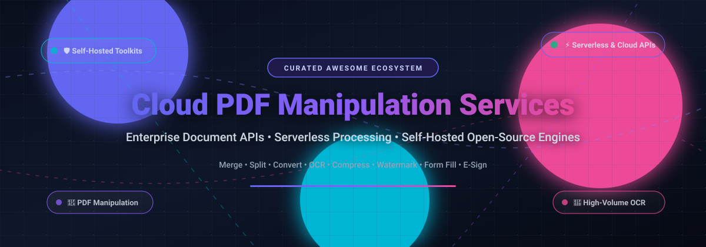

  

# 📑 Awesome Cloud PDF Manipulation Services 🚀

  
  
  
  
  
  
  

---

## 🎯 Overview & Scope

A curated, developer-first list of **Cloud PDF Manipulation Services**, **REST APIs**, and **Self-Hosted Open-Source Engines**. Whether you are automating serverless document pipelines, building enterprise document workflows, executing OCR data extraction, or self-hosting PDF toolkits to avoid per-transaction SaaS fees and safeguard privacy, this guide indexes the entire PDF ecosystem.

> 💡 **Keywords / SEO Topics**: PDF manipulation API, Cloud PDF editor, Server-side PDF generation, PDF convert merge split, HTML to PDF API, OCR document processing, Self-hosted PDF microservice, PDF SDK.

---

## 🧭 Table of Contents

- [📊 Sector Overview & Market Dynamics](#-sector-overview--market-dynamics)
- [☁️ SaaS & Hosted PDF Cloud APIs](#️-saas--hosted-pdf-cloud-apis)
- [💻 Open-Source PDF Engines & Toolkits](#-open-source-pdf-engines--toolkits)
- [🤝 How to Contribute](#-how-to-contribute)
- [💖 Support](#-support)
- [📈 Star History](#-star-history)
- [⚠️ Disclaimer](#️-disclaimer)

---

## 📊 Sector Overview & Market Dynamics

The global **PDF manipulation and editing software market** is estimated at **$4.1B – $5.5B**, while the adjacent **Intelligent Document Processing (IDP)** sector commands an additional **$3.5B+** and is growing rapidly (>30% CAGR) with AI/OCR adoption.

The industry exhibits a **moderately fragmented** structure: **Adobe** maintains an entrenched, near-monopolistic foundation across enterprise document standards, but market dynamics are not strictly "winner-take-all." A vibrant and competitive ecosystem of specialized cloud APIs (such as Apryse, Foxit, iLoveAPI, and CloudConvert) and privacy-focused, self-hosted open-source software (such as Stirling-PDF, PDF.js, and PyMuPDF) thrives by catering to developers who require lightweight integration, predictable costs, and strict data sovereignty.

---

## ☁️ SaaS & Hosted PDF Cloud APIs

All commercial SaaS and cloud-hosted PDF manipulation platforms sorted by company scale (revenue / market capitalization / valuation in descending order):

| Product | Company Scale (Revenue / Valuation) | Description | Starting Pricing | Free Tier / Trial Limit |
| :--- | :--- | :--- | :--- | :--- |
| **[Adobe PDF Services API](https://developer.adobe.com/document-services/apis/pdf-services/)** | **~$21B+ TTM Revenue** (~$100B Market Cap) | Enterprise-grade cloud document engine for create, convert, OCR, combine, export, compress, and form manipulation. | **$0.05 per document transaction** (volume tier discounts available; e.g., 25,000 transactions for ~$2,717/yr via CDW) | **6-month free trial** with an initial quota of free document transactions (PDF Embed API is permanently free) |
| **[Apryse (formerly PDFTron)](https://apryse.com/pricing)** | **>$3B Valuation** (>$100M EBITDA) | Full-stack enterprise document SDK and cloud processing suite offering server-side and client-side conversion, annotation, and redaction. | **$1,500/year** entry-level baseline package (modular pricing scales by volume, deployment mode, and modules) | **30-day free trial** with full SDK/API feature access for evaluation upon developer registration (no permanent free tier) |
| **[Foxit PDF Services API](https://app.developer-api.foxit.com/pricing)** | **~$160M–$180M Revenue** (~$746M Market Cap) | High-performance developer cloud API for PDF conversion, HTML rendering, merging, splitting, compression, and electronic signatures. | **$1,750/year** Startup plan (includes 5,000 unified credits; 1 credit/standard operation, 5 credits/envelope) | **Free sandbox testing account** with a limited pool of 100 test credits for API evaluation (no permanent production free tier) |
| **[iLoveAPI (iLovePDF)](https://www.iloveapi.com/pricing)** | **~$10M–$15M Est. Revenue** (Bootstrapped / Private) | High-throughput developer REST API wrapping the complete iLovePDF & iLoveIMG engine for merge, split, compress, Office-to-PDF, and OCR. | **$6.00/month** (Starter tier for 3,000 monthly credits) or **$11.00** prepaid pay-as-you-go credit packs (credits never expire) | **2,500 free credits/month** permanently with a free registered developer account (excludes paid digital signatures) |
| **[Smallpdf](https://smallpdf.com/pricing)** | **~$8M–$11M Est. Revenue** (Bootstrapped / Private) | Cloud document management platform offering PDF compression, conversion, e-signing, and editing workflows. | **$9.00/user/month** (Pro plan billed annually); programmatic API integration requires custom business onboarding | **2 free document tasks per day** on the web platform; **7-day free trial** for full Pro feature evaluation |
| **[CloudConvert](https://cloudconvert.com/pricing)** | **~$1M–$3M Est. Revenue** (Bootstrapped / Private) | Highly flexible multi-format cloud conversion API supporting PDF, DOCX, raster/vector images, CAD, audio, and video formats. | **$8.00** one-time pay-as-you-go package (500 conversion minutes) or **$8.00/month** recurring subscription | **10 free conversion credits/day** permanently (max 1 GB file size, up to 5 concurrent conversions, 5 min/task) |
| **[Zamzar API](https://developers.zamzar.com/pricing)** | **~$1M–$2M Est. Revenue** (Bootstrapped / Private) | Reliable multi-format file conversion API powering document, image, and PDF transformations with 100+ format targets. | **$25.00/month** Starter tier (500 conversion credits, 50 MB max file size, 100 concurrent requests) | **Free test sandbox** with **100 test credits**, 1 MB max file limit, and 1-day retention for integration testing |
| **[Sejda HTML to PDF API](https://www.sejda.com/developers)** | **~$1M–$2M Est. Revenue** (Bootstrapped / Private) | Dedicated cloud API for server-side HTML-to-PDF generation and document conversion with web font and JavaScript rendering. | **$12.00/month** Starter tier (200 requests/hour allowance, up to 3 concurrent connections) | **3 free tasks/hour** (up to 200 pages or 50 MB) on Sejda web apps; API requires an active subscription or sandbox key |

---

## 💻 Open-Source PDF Engines & Toolkits

Self-hosted, developer-friendly open-source alternatives to eliminate vendor lock-in, safeguard user data, and eliminate per-document transaction bills. Sorted by GitHub_Stars in descending order:

1. **[Stirling-PDF](https://github.com/Stirling-Tools/Stirling-PDF)**   
   *The definitive self-hosted web PDF manipulation suite & REST API.*  
   * **License**: GPL-3.0 | **Stack**: Java / Spring Boot / Docker / Vue  
   * **Features**: Full web UI and OpenAPI backend for merging, splitting, rotating, converting, OCR, watermarking, redacting, and signing documents entirely within your private infrastructure.

2. **[Docling (IBM)](https://github.com/DS4SD/docling)**   
   *Advanced document parsing and structure extraction for AI & RAG pipelines.*  
   * **License**: MIT | **Stack**: Python  
   * **Features**: Parses complex PDF layouts, reading orders, tables, equations, and images into clean Markdown/JSON representations tailored for LLM processing.

3. **[PDF.js](https://github.com/mozilla/pdf.js)**   
   *The industry-standard client-side browser PDF rendering engine.*  
   * **License**: Apache-2.0 | **Stack**: JavaScript / HTML5 Canvas  
   * **Features**: Mozilla's community-driven engine that renders PDFs in modern web browsers without native browser plugins.

4. **[Gotenberg](https://github.com/gotenberg/gotenberg)**   
   *A Docker-powered stateless API for converting HTML, Markdown, and Office documents to PDF.*  
   * **License**: MIT | **Stack**: Go / Chromium / LibreOffice / PDFtk / QPDF  
   * **Features**: Production-ready microservice orchestration for high-fidelity HTML-to-PDF rendering via headless Chromium and LibreOffice document conversion.

5. **[PyMuPDF (MuPDF)](https://github.com/pymupdf/PyMuPDF)**   
   *High-performance Python bindings for MuPDF rendering and document extraction.*  
   * **License**: AGPL-3.0 / Commercial | **Stack**: C / Python  
   * **Features**: Blazing fast text/image extraction, vector drawing, PDF manipulation, rendering, encryption, and layout inspection.

6. **[pypdf](https://github.com/py-pdf/pypdf)**   
   *Pure-Python PDF manipulation library with zero external dependencies.*  
   * **License**: BSD-3-Clause | **Stack**: Python  
   * **Features**: Splitting, merging, cropping, encrypting/decrypting, metadata extraction, form filling, and page transformations.

7. **[pdfcpu](https://github.com/pdfcpu/pdfcpu)**   
   *A command-line PDF processing processor and Go library.*  
   * **License**: Apache-2.0 | **Stack**: Go  
   * **Features**: Fast concurrent processing for slicing, stamping, watermarking, optimizing, encrypting, and validating PDF files.

8. **[pdf-lib](https://github.com/Hopding/pdf-lib)**   
   *Create and modify PDF documents in any JavaScript/TypeScript environment.*  
   * **License**: MIT | **Stack**: TypeScript / JavaScript (Node.js & Browser)  
   * **Features**: Embed images, draw text, merge/split pages, modify vector graphics, and read/fill interactive AcroForms without native dependencies.

9. **[pdfminer.six](https://github.com/pdfminer/pdfminer.six)**   
   *Community maintained Python tool for extracting structured text, layout, and font data.*  
   * **License**: MIT | **Stack**: Python  
   * **Features**: Deep analysis of font coordinates, glyph placement, text flow, and layout trees inside PDF documents.

10. **[QPDF](https://github.com/qpdf/qpdf)**   
    *C++ library and CLI for content-preserving transformations and structural PDF repair.*  
    * **License**: Apache-2.0 | **Stack**: C++  
    * **Features**: Linearization (web fast viewing), encryption, page selection, object stream generation, and low-level syntax inspection.

11. **[pdfme](https://github.com/pdfme/pdfme)**   
    *TypeScript PDF generation and visual schema-based template designer.*  
    * **License**: MIT | **Stack**: TypeScript / React  
    * **Features**: Drag-and-drop WYSIWYG PDF template builder paired with lightweight programmatic PDF generation for invoices, labels, and reports.

12. **[Sejda SDK](https://github.com/torakiki/sejda)**   
    *The extensible Java core engine behind Sejda's commercial platform.*  
    * **License**: AGPL-3.0 / Commercial PRO ($2,000/yr) | **Stack**: Java  
    * **Features**: High-volume programmatic merge, split, compress, watermark, form manipulation, and image-to-PDF transformations.

13. **[veraPDF](https://github.com/veraPDF/veraPDF-library)**   
    *Industry-benchmark open-source PDF/A and PDF/UA conformance validator.*  
    * **License**: GPL-3.0 / MPL-2.0 | **Stack**: Java  
    * **Features**: Authoritative validation engine supported by the PDF Association to ensure digital preservation and accessibility standards compliance.

---

## 🤝 How to Contribute

Contributions are welcome! Help keep this list comprehensive, accurate, and up to date.

1. 🍴 Fork the repository.
2. 🌿 Create your feature branch (`git checkout -b feature/add-service`).
3. 📝 Add or update entries following the established table / list formatting (ensure pricing and free tier specs are detailed).
4. 💾 Commit your changes (`git commit -m "feat: add NewService to SaaS table"`).
5. 🚀 Push to the branch (`git push origin feature/add-service`).
6. 📬 Open a Pull Request with a clear summary.

---

## 💖 Support

Thank you for exploring and using this curated list! If you found this resource helpful for your document processing pipelines and architecture research, please consider supporting the project:

- ⭐ **Star this repository** on GitHub to help others discover it.
- 🍴 **Fork and share** it with your fellow developers, engineers, and teams.
- ☕ **Buy me a coffee**: Support ongoing maintenance and curated updates directly via the [GitHub Sponsors Dashboard](https://github.com/sponsors/ishandutta2007).

---

## 📈 Star History

---

## ⚠️ Disclaimer

- 📖 **Independent Directory**: This repository is a community-curated technical index and is not affiliated with, sponsored by, or endorsed by Adobe, Foxit, Apryse, or any listed entity.
- 💰 **Pricing Transparency**: SaaS pricing models evolve regularly. Always verify current quotas, concurrency limits, and enterprise contracts on vendor websites prior to deployment.
- ⚖️ **Licensing Compliance**: Open-source tools under copyleft licenses (e.g., AGPL-3.0, GPL-3.0) may require corresponding commercial licenses (e.g., Sejda PRO, PyMuPDF Commercial) for closed-source or SaaS deployment. Always audit license terms against your application architecture.

---

  Built with ❤️ for developers, document engineers, and software architects building scalable cloud PDF workflows.

